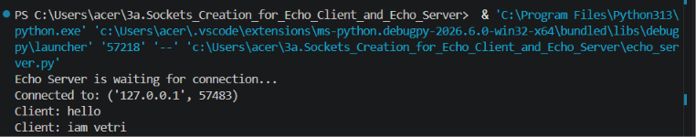
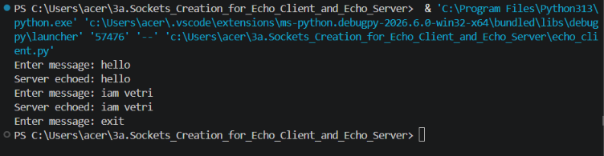

# 3a.CREATION FOR ECHO CLIENT AND ECHO SERVER USING TCP SOCKETS

### Name: M.Vetrivel
### Register Number: 212225040487
### Date: 18-11-2026


# AIM
To write a python program for creating Echo Client and Echo Server using TCP
Sockets Links.
## ALGORITHM:
1. Import the necessary modules in python
2. Create a socket connection to using the socket module.
3. Send message to the client and receive the message from the client using the Socket module in
 server .
4. Send and receive the message using the send function in socket.
## PROGRAM

echo_client.py
```py

import socket

# Create socket object
client_socket = socket.socket(socket.AF_INET, socket.SOCK_STREAM)

# Connect to server
host = '127.0.0.1'
port = 5000

client_socket.connect((host, port))

while True:
    # Input message
    message = input("Enter message: ")

    # Send message to server
    client_socket.send(message.encode())

    if message.lower() == 'exit':
        break

    # Receive echoed message
    data = client_socket.recv(1024).decode()

    print("Server echoed:", data)

# Close socket
client_socket.close()

```

echo_server.py
```py

import socket

# Create socket object
server_socket = socket.socket(socket.AF_INET, socket.SOCK_STREAM)

# Bind the socket with host and port
host = '127.0.0.1'
port = 5000
server_socket.bind((host, port))

# Listen for incoming connections
server_socket.listen(1)

print("Echo Server is waiting for connection...")

# Accept client connection
client_socket, addr = server_socket.accept()
print("Connected to:", addr)

while True:
    # Receive message from client
    data = client_socket.recv(1024).decode()

    if not data:
        break

    print("Client:", data)

    # Send same message back to client
    client_socket.send(data.encode())

# Close sockets
client_socket.close()
server_socket.close()


```
## OUPUT




## RESULT
Thus, the python program for creating Echo Client and Echo Server using TCP Sockets Links 
was successfully created and executed.
